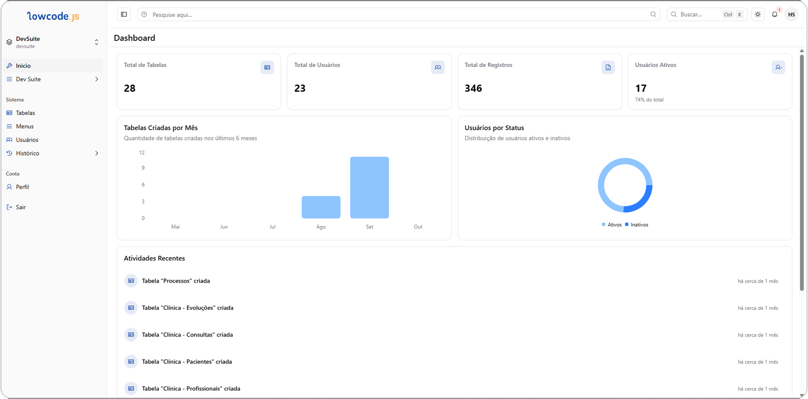

# LowCodeJS

LowCodeJS é uma plataforma low-code para criar aplicações internas sem
escrever código: tabelas dinâmicas, formulários, dashboards e automações,
tudo montado pela interface.

Pense em algo parecido com Notion, Airtable ou Coda: você desenha a estrutura
de dados (as tabelas e seus campos), escolhe como quer visualizá-la (lista,
kanban, calendário, fórum...), decide quem pode ver e editar cada pedaço, e a
plataforma cuida do resto — banco de dados, formulários, permissões,
notificações.

*Painel de Dashboard com cartões de métrica, gráficos e atividade recente.*

## Para quem é esta documentação

Para quem **usa** a plataforma: monta tabelas, configura formulários,
organiza dashboards, define permissões e automações pela interface. Não é
preciso saber programar para seguir a maior parte deste guia — exceto nas
seções de instalação e administração, que assumem conhecimento básico de
Docker para quem for hospedar a própria instância.

## O que dá para construir

- **CRMs, ERPs e portais internos** — cadastros relacionados entre si, com
  permissões por grupo, por tabela e até por linha.
- **Fluxos de aprovação e formulários** — com automações que rodam quando um
  registro é criado, editado ou carregado.
- **Catálogos e bases de conhecimento** — publicados em diferentes
  visualizações (galeria, documento, mosaico).
- **Quadros de tarefas e processos** — Kanban com colunas, comentários e
  menções; ou um processo modelado visualmente com o BPM Modeler.
- **Painéis de indicadores** — dashboards com gráficos e cartões de métrica
  construídos sobre os dados das próprias tabelas.

## Principais capacidades

| Área | O que oferece |
| --- | --- |
| **Tabelas** | Campos configuráveis (texto, data, dropdown, relacionamento, arquivo, categoria, avaliação, e mais), validações, permissões por tabela/campo/linha |
| **Visualizações** | 9 estilos — Lista, Galeria, Documento, Cartões, Mosaico, Kanban, Fórum, Calendário e Gantt |
| **Dashboards** | Gráficos e cartões de métrica sobre os dados das tabelas |
| **Automações** | Scripts que rodam ao salvar ou carregar um registro, e um modelador visual de processos (BPM) |
| **Permissões** | Grupos de usuário com hierarquia, capacidades por área, permissões por ação em cada tabela e perfis de membro |
| **Ambientes** | Múltiplos workspaces isolados dentro da mesma instalação |
| **Ferramentas** | Clonar tabela, importar/exportar, gerar dados de teste, cofre de senhas, importar de outra instalação |
| **Assistente de IA** | Chat integrado que entende o contexto das suas tabelas |
| **Extensões** | Plugins, módulos e ferramentas que ampliam a plataforma sem alterar o núcleo |

## Por onde começar

- [Visão Geral da Interface](getting-started/overview.md) — um tour pelas
  áreas principais e pelo menu lateral.
- [Primeiros Passos](getting-started/quickstart.md) — crie sua primeira
  tabela em poucos minutos.
- [Instalação](getting-started/installation.md) — como hospedar sua própria
  instância via Docker.

## Estrutura desta documentação

- **Primeiros Passos** — tour da interface e primeira tabela
- **Tabelas** — campos, formatos, validações, relacionamentos, permissões.
- **Visualizações** — os 9 estilos de exibição de uma tabela.
- **Dashboards** — gráficos e métricas.
- **Automações** — scripts e o modelador de processos (BPM).
- **Ferramentas** — os utilitários do menu Ferramentas.
- **Configurações** — o que o usuário MASTER configura para toda a
  instalação.
- **Administração** — deploy e segurança, para quem hospeda a própria
  instância.
