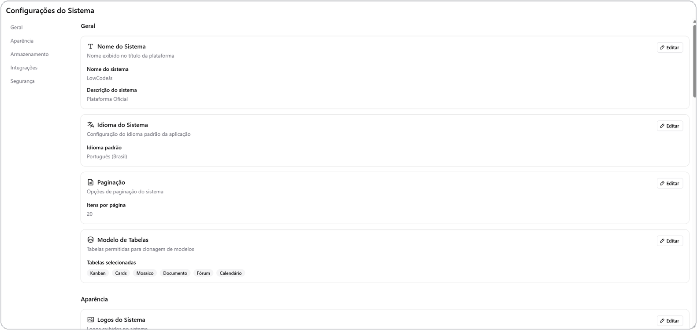

# Tela de Configurações

A tela de **Configurações** reúne os ajustes que valem para toda a
instalação — restrita ao usuário **MASTER**. Cada bloco de configuração é
independente e pode ser alterado a qualquer momento.

## O que dá para configurar

| Bloco | O que controla |
| --- | --- |
| **Nome do sistema** | Nome e identidade da instalação, exibidos na interface |
| **Logos** | Logo pequeno e logo grande da instalação |
| **Idioma** | Idioma/locale padrão da interface |
| **Imagem de fundo do login** | Imagem de fundo da tela de entrada |
| **E-mail (SMTP)** | Servidor de envio de e-mail, usado por notificações e automações |
| **Paginação** | Quantidade padrão de itens por página nas listagens |
| **Upload** | Limites e comportamento de envio de arquivos |
| **Armazenamento** | Local (no próprio servidor) ou S3 — ver [Armazenamento](storage.md) |
| **Repositório de Apps** | Catálogo de apps instaláveis — ver [Repositório de Apps](apps-repository.md) |
| **Assistente de IA** | Chave e ativação do chat com IA — ver [Assistente de IA](ai-assistant.md) |
| **Banco das tabelas de dados** | Somente leitura: mostra se a instalação usa o banco interno ou PostgreSQL para os dados das tabelas — decidido na instalação e não muda depois |
| **Histórico de auditoria** | Acesso ao registro de ações realizadas na instalação |
| **Modelo de Tabelas** | Quais tabelas ficam disponíveis como modelo pronto na tela de criação de tabela (Kanban, Cartões, Mosaico, Documento, Fórum, Calendário) |

*Tela de Configurações: cada bloco (Nome do Sistema, Idioma, Paginação, Modelo de Tabelas, Logos...) é editado de forma independente.*

## Quem acessa

Apenas o usuário **MASTER** enxerga e altera a tela de Configurações —
outros grupos (Administrador, Gerente, Registrado) não têm acesso, mesmo que
tenham outras permissões elevadas em tabelas específicas.

## Configurações feitas em outro lugar

Algumas configurações relacionadas não ficam nesta tela, mas em áreas
próprias do menu lateral:

- **Usuários e Grupos** (permissões, capacidades, hierarquia) — ver
  [Usuários e Grupos](users-and-groups.md).
- **Ambientes** (workspaces) — ver [Ambientes (Workspaces)](workspaces.md).
- **Extensões** (ativar/desativar plugins, módulos e ferramentas) — ver
  [Visão geral das ferramentas](../tools/overview.md).

## Próximos passos

- [Usuários e Grupos](users-and-groups.md)
- [Armazenamento](storage.md)
- [Assistente de IA](ai-assistant.md)
