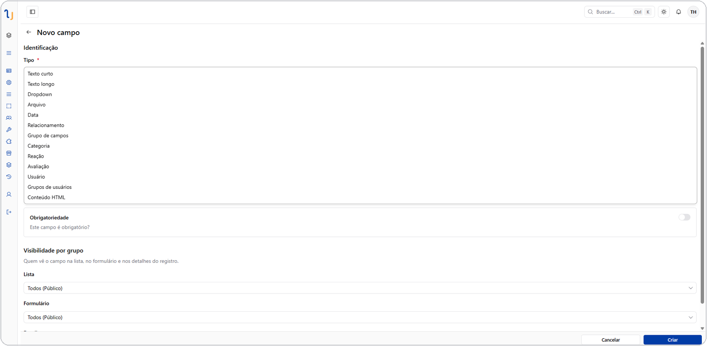

# Tipos de campo

Cada campo de uma tabela tem um **tipo**, que define que tipo de informação
ele guarda e como aparece no formulário e na listagem. Alguns tipos aceitam
também um [formato](field-formats.md) (ex.: um texto curto pode ser um
e-mail) e qualquer campo pode receber [validações](field-validations.md)
adicionais (ex.: obrigatório, único).

## Tipos configuráveis

*Criação de um campo novo: a lista completa de tipos disponíveis, à escolha.*

Estes são os tipos que você escolhe ao criar um campo novo.

| Tipo | O que é | Exemplo de uso |
| --- | --- | --- |
| **Texto curto** | Um texto de uma linha. Aceita [formatos](field-formats.md) como e-mail, CPF, telefone, URL, número inteiro ou decimal | Nome, e-mail, CPF, telefone, código |
| **Texto longo** | Um texto de várias linhas, em formato simples ou rico (com negrito, listas, links — editor de texto completo) | Descrição, observações, corpo de uma mensagem |
| **Dropdown** | Uma lista de opções pré-definidas, cada uma com uma cor própria. Pode ser de seleção única ou múltipla | Status, categoria, prioridade, lista de um Kanban |
| **Data** | Uma data, com ou sem horário, em vários formatos de exibição | Data de nascimento, prazo, data/hora de um evento |
| **Relacionamento** | Liga a tabela a outra tabela (ou a ela mesma), em qualquer cardinalidade (1:1, 1:N, N:N) | Pedido → Cliente, Tarefa → Projeto |
| **Arquivo** | Upload de um ou mais arquivos (imagens, documentos, etc.), com suporte a envio em partes e retomada | Foto do produto, anexo, comprovante |
| **Grupo de campos** | Um conjunto de campos que se repete dentro do registro, como uma "subtabela" embutida | Itens de um pedido, tarefas de um quadro Kanban |
| **Reação** | Reações rápidas a um registro (como curtidas/emojis) | Reações a uma postagem de fórum |
| **Avaliação** | Uma nota/avaliação atribuída ao registro | Avaliação de atendimento, nota de satisfação |
| **Categoria** | Seleciona valores de uma árvore de categorias, com nós que apenas agrupam e nós que podem ser escolhidos | Categoria de produto, departamento/setor |
| **Usuário** | Referencia um ou mais usuários da instalação | Responsável, aprovador |
| **Grupo de usuários** | Referencia um ou mais grupos de permissão | Equipe responsável |
| **Conteúdo HTML** | Um bloco de conteúdo HTML fixo, definido na configuração do campo (não editável linha a linha) | Texto institucional, aviso fixo no formulário |

## Campos nativos (automáticos)

Estes campos são criados e mantidos pela própria plataforma — não aparecem
na lista de tipos ao criar um campo novo, mas podem ser mostrados ou
escondidos nas telas de lista, formulário e detalhe:

| Campo nativo | O que registra |
| --- | --- |
| **Identificador** | O id único do registro |
| **Criador** | Quem criou o registro |
| **Criado em** | Data/hora de criação |
| **Modificado por** | Quem fez a última alteração |
| **Modificado em** | Data/hora da última alteração |
| **Enviado para lixeira em** | Data/hora em que foi movido para a lixeira |
| **Status** | Estado interno do registro |

## Opções comuns a (quase) todo campo

Independentemente do tipo, ao configurar um campo você normalmente define:

- **Obrigatório** — exige valor antes de salvar.
- **Múltiplo** — aceita mais de um valor (ex.: vários arquivos, várias
  opções de dropdown).
- **Valor padrão** — valor sugerido ao criar um novo registro.
- **Dica** — texto de ajuda exibido junto ao campo.
- **Mostrar no filtro** — se o campo aparece como opção na barra de filtros.
- **Rótulo por contexto** — um nome diferente do nome original do campo para
  lista, filtro, formulário ou detalhe.
- **Largura** — largura do campo em cada contexto (formulário, lista,
  detalhe).
- **Limite de chips visíveis** — para campos com múltiplos valores (dropdown,
  relacionamento, usuário, grupo de usuários), quantas opções mostrar antes
  de resumir o restante em "+N".

## Próximos passos

- [Formatos de campo](field-formats.md)
- [Validações de campo](field-validations.md)
- [Relacionamentos](relationships.md)
- [Grupos de campos](field-groups.md)
