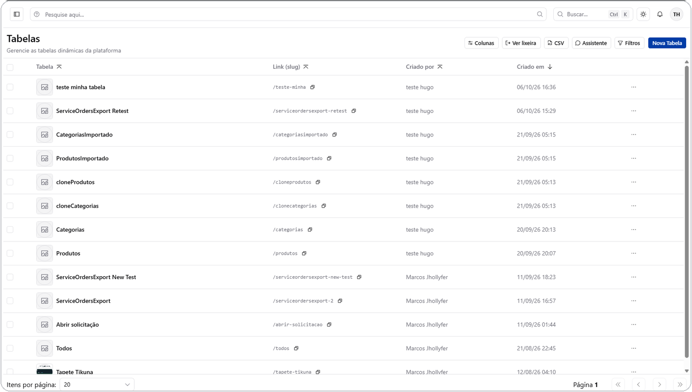

# O que é uma tabela

Uma **tabela** é a unidade básica da plataforma: um conjunto de registros com
a mesma estrutura de campos, parecido com uma planilha, mas com tipos de
dado, validações, relacionamentos e permissões de verdade.

É sobre tabelas que tudo mais se constrói: visualizações (Kanban, Calendário,
Fórum...), dashboards, automações e permissões.

## Criando uma tabela

No menu **Tabelas**, use o botão de criar nova tabela e informe um nome. A
plataforma gera automaticamente um identificador único (**slug**) a partir do
nome — é esse slug que aparece na URL da tabela e a identifica internamente.

Você pode:

- Começar **do zero**, adicionando campos um a um.
- Usar um **modelo pronto** (Kanban, Cartões, Mosaico, Documento, Fórum,
  Calendário) pela ferramenta [Clonar Tabela](../tools/clone-table.md), que já
  entrega os campos certos para aquele estilo.
- **Clonar** a estrutura (e, opcionalmente, os dados) de uma tabela já
  existente no mesmo ambiente.
- Instalar uma tabela pronta a partir do
  [Repositório de Apps](../settings/apps-repository.md).

*Listagem de tabelas do ambiente, com o botão "Nova Tabela" no canto superior direito.*

## Dono e membros

Toda tabela tem um **dono** (owner) — normalmente quem a criou — e pode ter
**membros** adicionais, cada um com um perfil de acesso (Dono, Admin, Editor,
Colaborador, Visualizador). Veja o detalhamento completo em
[Permissões de tabela](permissions.md).

## Campos nativos

Toda tabela nasce com alguns campos automáticos, que a plataforma mantém
sozinha — não aparecem como opção ao criar um campo novo, mas podem ser
exibidos ou ocultados nas telas:

| Campo nativo | O que registra |
| --- | --- |
| Identificador | O id único do registro |
| Criador | Quem criou o registro |
| Criado em | Data/hora de criação |
| Modificado por | Quem fez a última alteração |
| Modificado em | Data/hora da última alteração |
| Enviado para lixeira em | Data/hora em que o registro foi enviado à lixeira (soft delete) |
| Status | Estado interno do registro |

## Lixeira

Registros, campos e tabelas removidos não desaparecem na hora — vão para uma
lixeira e podem ser restaurados, até que alguém com permissão os exclua
definitivamente.

## Estrutura dinâmica

Diferente de um banco de dados tradicional, a estrutura de uma tabela
(quais campos existem, de que tipo) pode ser alterada a qualquer momento pela
interface, sem exigir migração manual: adicionar, renomear ou remover um
campo é uma operação da própria UI.

## Próximos passos

- [Tipos de campo](field-types.md) — o catálogo completo de tipos de campo.
- [Relacionamentos](relationships.md) — como ligar tabelas entre si.
- [Permissões de tabela](permissions.md) — quem pode ver e editar o quê.
