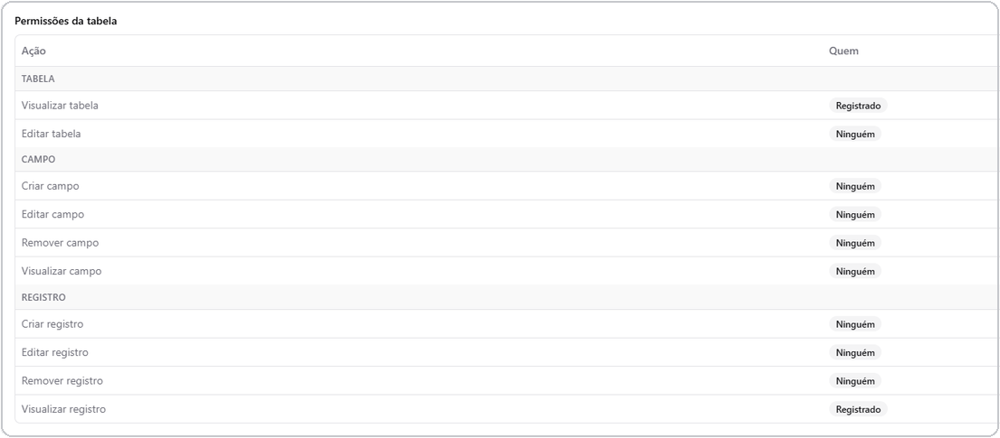

# Permissões de tabela

Cada tabela controla, de forma independente, quem pode vê-la, criar, editar
e remover seus campos e registros. Isso se soma às
[permissões gerais de grupo](../settings/users-and-groups.md) — uma pessoa
só consegue fazer algo numa tabela se tiver tanto a capacidade geral quanto a
permissão específica daquela tabela liberando a ação.

## Dono e membros

Toda tabela tem um **dono** e pode ter **membros** adicionais. Cada membro
recebe um **perfil**, que define o que ele pode fazer:

| Perfil | Pode ver tabela/registros | Pode criar/editar campos | Pode criar registros | Pode editar/remover registros |
| --- | --- | --- | --- | --- |
| **Dono** | Sim | Sim | Sim | Qualquer registro |
| **Admin** | Sim | Sim | Sim | Qualquer registro |
| **Editor** | Sim | Não | Sim | Qualquer registro |
| **Colaborador** | Sim | Não | Sim | **Apenas os próprios registros** |
| **Visualizador** | Sim (somente leitura) | Não | Não | Não |

O **Dono** é o único que pode transferir a titularidade da tabela para outro
usuário, e também pode excluir a tabela.

*Permissões da tabela: cada ação de Tabela, Campo e Registro é liberada para Ninguém, Registrado (qualquer pessoa) ou um grupo específico.*

## Permissões por ação

Além do perfil de membro, cada tabela define, para cada uma das ações
abaixo, quem pode executá-la: **ninguém**, **qualquer pessoa** (inclusive
visitante não autenticado, quando a tabela é pública) ou **um grupo
específico**.

| Área | Ações controladas |
| --- | --- |
| **Tabela** | Ver, Criar, Editar, Remover |
| **Campo** | Ver, Criar, Editar, Remover |
| **Registro** | Ver, Criar, Editar, Remover |

Quando a permissão é liberada para um **grupo específico**, a liberação só
vale para quem está nesse grupo **e** cuja função já inclui aquela
capacidade de forma geral na instalação — as duas condições precisam ser
verdadeiras ao mesmo tempo. Donos, membros com perfil específico e
permissões "qualquer pessoa" não passam por essa checagem dupla.

## Permissões por campo

Cada campo, independentemente da permissão geral da tabela, pode ser
mostrado ou escondido separadamente em três contextos:

- **Lista** — se aparece como coluna na listagem.
- **Formulário** — se aparece (e pode ser preenchido) ao criar/editar um
  registro.
- **Detalhe** — se aparece na tela de detalhe do registro.

Isso permite, por exemplo, um campo "Custo interno" que aparece no detalhe
para quem administra a tabela, mas fica oculto da listagem geral e do
formulário de quem só cria registros.

## Tabelas públicas

Uma tabela pode ser configurada para que suas ações de visualização (e,
dependendo da configuração, também criação) fiquem abertas a qualquer
pessoa, mesmo sem login — útil para formulários públicos ou catálogos
abertos.

## Próximos passos

- [Usuários e Grupos](../settings/users-and-groups.md) — como funcionam os
  grupos e suas capacidades gerais.
- [Tipos de campo](field-types.md)
