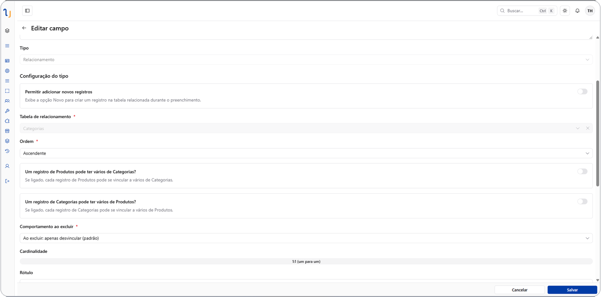

# Relacionamentos

O campo do tipo **Relacionamento** liga uma tabela a outra — ou a ela mesma —
permitindo que um registro referencie um ou mais registros de outra tabela.
É assim que você monta estruturas como Pedido → Cliente, Tarefa → Projeto, ou
Funcionário → Departamento.

## Cardinalidade

A cardinalidade do relacionamento (quantos registros de um lado podem se
ligar a quantos do outro) é definida pela combinação das duas pontas do
campo:

| Cardinalidade | Significado | Exemplo |
| --- | --- | --- |
| **1:1** | Um registro de cada lado se liga a no máximo um do outro | Funcionário ↔ Crachá |
| **1:N** | Um registro de um lado pode se ligar a vários do outro, mas cada um destes se liga a apenas um | Cliente → vários Pedidos |
| **N:N** | Registros de ambos os lados podem se ligar livremente entre si | Produto ↔ várias Categorias |

## Configurações do relacionamento

*Edição de um campo de Relacionamento: tabela relacionada, cardinalidade (1:1 no exemplo) e comportamento ao excluir.*

Ao criar um campo de Relacionamento, você escolhe:

- **Tabela relacionada** — a outra ponta do vínculo.
- **Limite de vínculos** — um número máximo de registros que podem ser
  ligados nesse lado, ou sem limite.
- **Modo de exibição no formulário**:
  - **Seleção** (`select`) — um campo de múltipla escolha direto no
    formulário, para escolher rapidamente os registros vinculados.
  - **Gestão** (`manage`) — uma tabela interna (ou cards) dentro da tela de
    detalhe, para gerenciar os vínculos com mais contexto, como se fosse uma
    mini-tabela embutida.
- **Rótulo customizado** — em vez de mostrar só um campo da tabela
  relacionada como rótulo da opção, é possível compor o rótulo a partir de
  vários campos (inclusive de tabelas relacionadas a ela), separados por um
  texto à sua escolha. Por exemplo, mostrar "João Silva — São Paulo/SP" em
  vez de apenas "João Silva".
- **Visibilidade** — se a tabela interna de gestão aparece na tela de
  detalhe daquele lado.

## Comportamento ao excluir (onDelete)

Quando um registro ligado por relacionamento é excluído, a plataforma precisa
decidir o que acontece do outro lado do vínculo. Essa regra é configurada por
relacionamento:

| Comportamento | O que acontece |
| --- | --- |
| **Cascata (CASCADE)** | Os registros vinculados também são removidos |
| **Define como nulo (SET NULL)** | O vínculo é desfeito, mas o registro do outro lado permanece, apenas sem a referência |
| **Restringe (RESTRICT)** | A exclusão é bloqueada enquanto existirem vínculos — é preciso desvincular antes |

## Criando registros relacionados na hora

Dependendo da configuração, é possível criar um novo registro na tabela
relacionada sem sair do formulário atual — útil quando o registro que você
precisa vincular ainda não existe.

## Próximos passos

- [Tipos de campo](field-types.md)
- [Grupos de campos](field-groups.md) — uma alternativa para dados que não
  precisam virar uma tabela própria.
