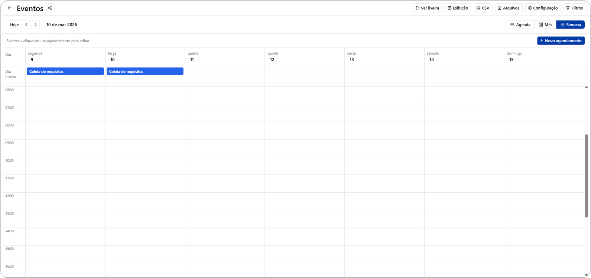

# Calendário e Gantt

Duas visualizações voltadas para quem trabalha com datas, prazos e
planejamento de atividades.

## Calendário

Exibe os registros posicionados num calendário, segundo suas datas de início
e término.

### Campos necessários

Para a visualização de Calendário ficar disponível, a tabela precisa ter:

- Um campo de texto curto para o **título** do evento.
- Um campo de texto longo para a **descrição**.
- Um campo de **data de início**.
- Um campo de **data de término**.
- Um campo de dropdown para a **cor** do evento.

### O que a visualização oferece

- Navegação por mês/semana/dia.
- Eventos coloridos conforme o campo de cor configurado.
- Clique para abrir o registro completo.

*Visualização de Calendário em modo semana, com os eventos posicionados pelas datas de início e término.*

## Gantt

Mostra as tarefas de uma tabela como barras numa linha do tempo, com duração
e sequência — útil para visualizar o cronograma de um projeto inteiro de uma
vez.

O Gantt reaproveita a mesma estrutura de tarefas usada pelo
[Kanban](kanban.md): sempre que uma tabela tem a estrutura de Kanban
configurada (dropdown de lista + grupo de campos de tarefas), a visualização
Gantt também fica disponível para ela.

## Começando com um modelo pronto

A ferramenta [Clonar Tabela](../tools/clone-table.md) oferece um modelo
pronto de Calendário, já com os campos de título, descrição, datas e cor
configurados. Para o Gantt, use o modelo de Kanban — ele já habilita as duas
visualizações.

## Próximos passos

- [Kanban](kanban.md)
- [Tipos de campo](../tables/field-types.md) — detalhes do campo Data e seus
  formatos.
