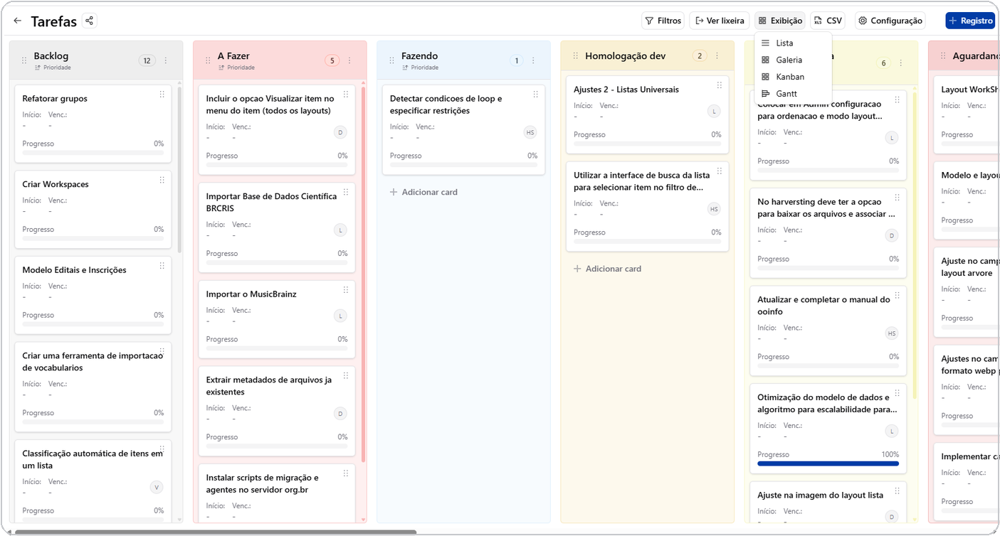

# Kanban

O Kanban exibe os registros como cartões organizados em colunas, com
arrastar-e-soltar entre elas — o estilo clássico de quadro de tarefas.

## Como as colunas são definidas

As colunas do quadro vêm das **opções de um campo Dropdown** da tabela (por
exemplo, um campo "Status" com as opções "A fazer", "Em andamento",
"Concluído"). Cada opção de dropdown vira uma coluna, na cor configurada
naquela opção.

Ao arrastar um cartão de uma coluna para outra, o valor do campo dropdown
daquele registro é atualizado automaticamente.

*Quadro Kanban: cada coluna vem de uma opção do campo Dropdown, e os cartões podem ser arrastados entre elas.*

## Ordenação dos cards dentro da coluna

Cada opção de dropdown pode ter sua própria ordenação de cards (por um campo
e direção escolhidos), definindo em que ordem os cartões aparecem dentro
daquela coluna.

## O que aparece no cartão

O cartão do Kanban normalmente mostra um título, uma descrição resumida e
indicadores visuais configurados nos campos da tabela — como membros
responsáveis, progresso de tarefas internas e cor da coluna.

## Tarefas dentro do cartão

Um cartão de Kanban pode conter uma lista de subtarefas, modelada como um
[grupo de campos](../tables/field-groups.md) com um título e uma marcação de
concluída por tarefa — é assim que o modelo pronto de Kanban (ver
[Clonar Tabela](../tools/clone-table.md)) já vem configurado.

## Comentários e menções

Cartões do Kanban suportam comentários, com suporte a menção de outro
usuário (`@usuário`). Quem é mencionado recebe uma notificação em tempo
real.

## Começando com um modelo pronto

A forma mais rápida de ter um Kanban funcional é usar o modelo pronto de
Kanban pela ferramenta [Clonar Tabela](../tools/clone-table.md), que já
inclui os campos de lista (dropdown), tarefas e comentários configurados
corretamente.

## Pré-requisitos para habilitar manualmente

Se estiver montando a estrutura do zero, a visualização Kanban exige, no
mínimo: um campo Dropdown para servir de lista/coluna, um grupo de campos de
tarefas (com título e marcação de concluída) e um grupo de campos de
comentários.

## Próximos passos

- [Calendário e Gantt](calendar-gantt.md) — o Gantt usa a mesma estrutura de
  tarefas do Kanban, em formato de linha do tempo.
- [Grupos de campos](../tables/field-groups.md)
